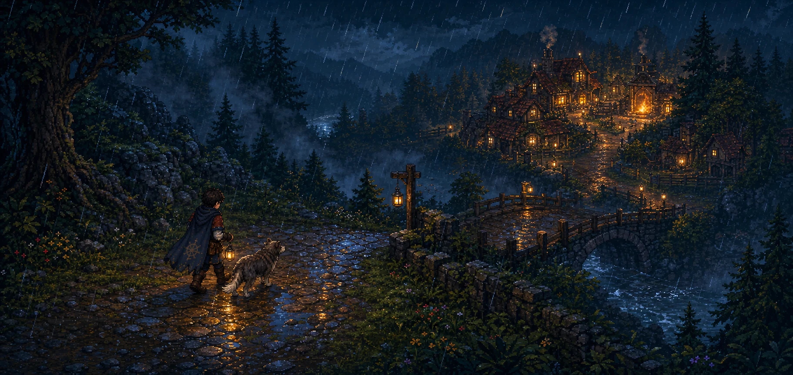
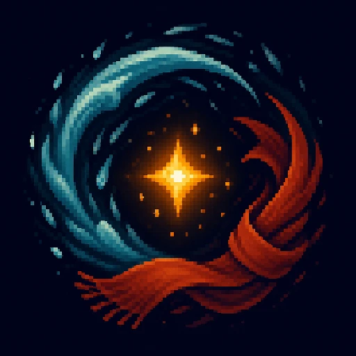
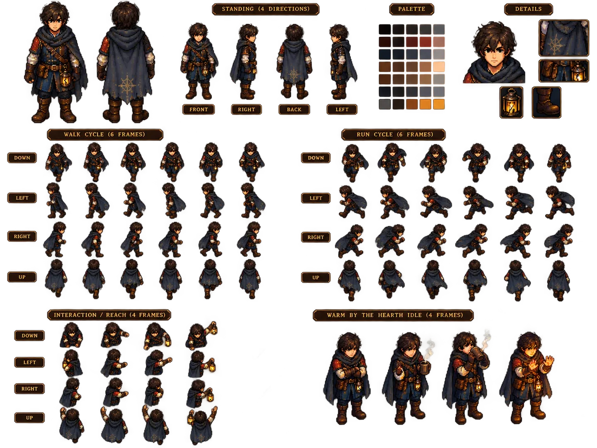
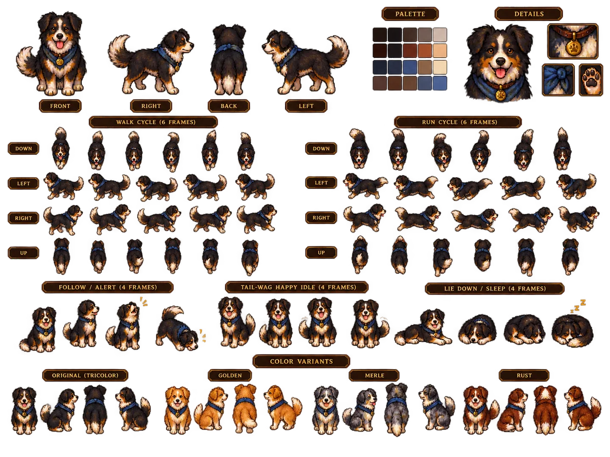
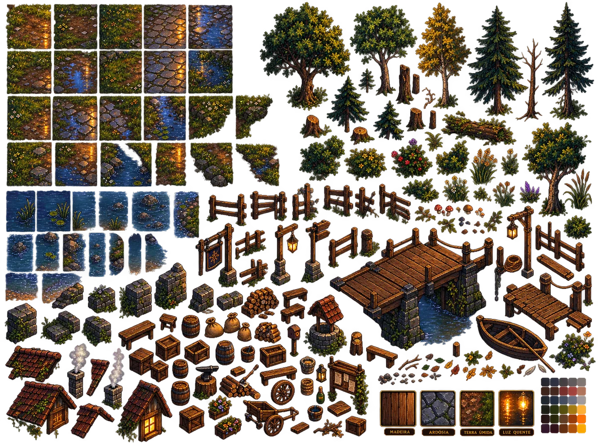
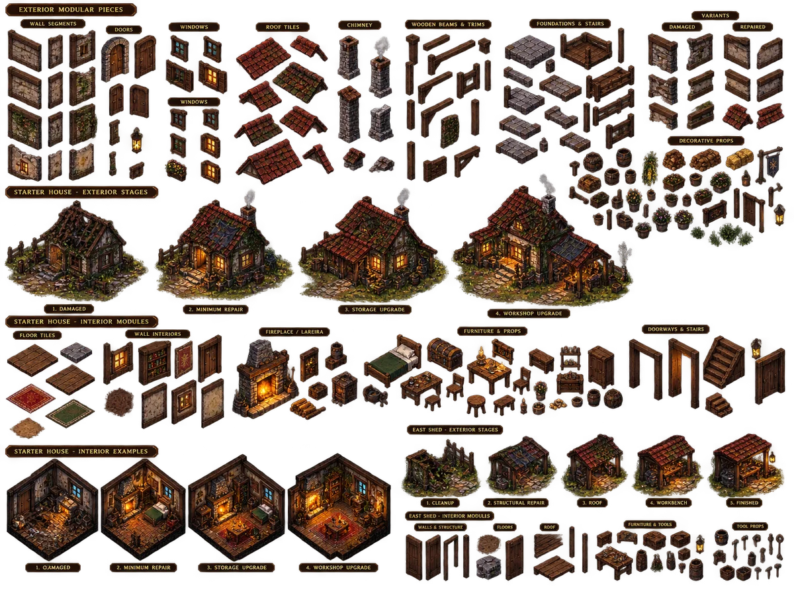

  

  

<h1 align="center">Fire Side</h1>

  <strong>A estrada importa porque existe um lugar que vale a pena reencontrar.</strong> 
  <em>The road matters because there is somewhere worth returning to.</em>

  RPG 2D de ação · Campanha PvE · Mundo persistente · Windows · Linux · Android

> **Em desenvolvimento.** Fire Side ainda não possui build pública. Esta é a vitrine oficial do projeto; downloads só aparecerão aqui depois de validação real nas três plataformas.

## Uma aventura sobre partir — e ter para onde voltar

Fire Side é um RPG 2D top-down sobre exploração, combate e pertencimento. Você atravessa estradas, florestas, rios, vilas e ruínas; enfrenta uma campanha PvE em tempo real; constrói relações; cuida do que conquistou; e vê o mundo guardar as consequências das suas escolhas.

Mas o coração do jogo está no contraste.

Lá fora, a noite é fria. A chuva apaga distâncias. O perigo ocupa o espaço entre uma luz e outra. Dentro de casa, a madeira estala, o cão encontra um canto perto do fogo e o ritmo do mundo muda sem precisar mostrar uma barra de “aconchego”.

Essa passagem — do mundo distante para um lugar íntimo — é a assinatura de Fire Side.

## Chegada e Fogo

O primeiro recorte jogável começa pequeno de propósito:

1. chegar sozinho à Estrada Leste durante uma tempestade;
2. ouvir um cão perdido além da curva;
3. cruzar a ponte e enxergar Pedra Mansa pela primeira vez;
4. encontrar uma casa danificada, mas possível;
5. fechar a porta, acender a lareira e descansar;
6. acordar diante das brasas e perceber que aquele lugar começou a virar lar.

É uma cena simples. Para funcionar, movimento, chuva, câmera, toque, iluminação, áudio, persistência e atuação visual precisam contar a mesma história.

## Direção visual

Chamamos nossa linguagem de **Modern Pixel Naturalism**: pixel art moderna, silhuetas legíveis, materiais densos, natureza com presença e luz usada com intenção. A meta não é encher a tela de efeitos; é fazer cada detalhe ajudar o jogador a sentir distância, perigo, beleza ou abrigo.

<table>
  <tr>
    <td width="50%" align="center">
       
      <strong>O viajante</strong> — proporções menos chibi, leitura corporal e equipamento com história.
    </td>
    <td width="50%" align="center">
       
      <strong>O Cão da Chuva</strong> — vínculo comunicado por postura, distância e movimento.
    </td>
  </tr>
  <tr>
    <td width="50%" align="center">
       
      <strong>Pedra Mansa</strong> — pedra molhada, madeira, água e vegetação compondo um lugar reconhecível.
    </td>
    <td width="50%" align="center">
       
      <strong>Casa Inicial</strong> — um lar que muda, guarda marcas e cresce junto com a campanha.
    </td>
  </tr>
</table>

Arte de direção em desenvolvimento. Estes estudos definem linguagem, escala e atmosfera; não são screenshots de uma build final.

## O que queremos que você faça e sinta

| No mundo | Em casa |
|---|---|
| explorar rotas, florestas, rios, ruínas e assentamentos | reparar, organizar e transformar um espaço seu |
| enfrentar criaturas com ataques legíveis e decisões rápidas | desacelerar sem transformar conforto em checklist |
| descobrir pistas, pessoas e histórias pela observação | perceber companhia, rotina, fogo e memória pelo ambiente |
| alterar economia, ecologia e acesso através de escolhas | reencontrar consequências concretas quando voltar |

Fire Side não separa “aventura” e “vida tranquila” em dois jogos diferentes. Uma dá sentido à outra.

## Combate e controles

O combate é PvE em tempo real, com leitura clara de intenção. Ataque rápido, ataque carregado, esquiva, interação contextual e mira precisam funcionar com precisão no computador e com naturalidade no toque.

| Ação | Teclado e mouse | Toque |
|---|---|---|
| Movimento | `WASD` | joystick virtual |
| Mira | mouse | direção assistida e gesto |
| Ataque | botão esquerdo | toque de ataque |
| Ataque carregado | segurar botão esquerdo | manter pressionado |
| Esquiva | `Espaço` | botão de esquiva |
| Interação | `E` | ação contextual |

Os bindings ainda podem mudar. A interface mobile está sendo criada para landscape desde o início, não espremida depois de uma versão de PC.

## Mundo que se lembra

Uma mina reaberta pode devolver trabalho à vila, alterar a oferta de minério e baratear ferramentas. Uma ponte reparada muda rotas. Uma criatura afastada altera a segurança de uma região. Uma casa recuperada ganha móveis, oficina, armazenamento e histórias.

O objetivo é que progresso não seja apenas um número maior, mas uma mudança que você consegue reconhecer quando volta ao lugar.

## Plataformas

| Plataforma | Compromisso atual |
|---|---|
| Windows | target de primeira classe; export acompanhado com Linux e Android |
| Linux | desenvolvimento e validação principal do runtime atual |
| Android | interface touch e perfil Mobile tratados como parte do jogo |

O projeto usa **Godot 4.7.2** e GDScript tipado. Requisitos mínimos, instaladores e APK só serão publicados quando houver evidência reproduzível em hardware adequado.

## Estado do projeto

Estamos construindo o primeiro vertical slice, **Chegada e Fogo**. Já existem fundações de runtime, input, clima, lareira, companheiro, persistência, conteúdo data-driven e export desktop; a direção visual de alta fidelidade ainda está sendo decomposta e validada dentro do jogo.

O que ainda não existe não será vendido como pronto:

- não há demo pública;
- não há APK público;
- não há data de lançamento anunciada;
- imagens marcadas como arte de direção não são gameplay.

Quando uma build estiver pronta para pessoas de fora do desenvolvimento, ela aparecerá em **Releases** com versão, plataforma, checksum, instruções e problemas conhecidos.

## Acompanhe

- marque este repositório com uma estrela para reencontrar o projeto;
- acompanhe **Releases** para builds oficiais futuras;
- use **Issues** quando o primeiro ciclo público de testes for aberto.

---

   
  <strong>Fire Side</strong> 
  Um mundo para explorar. Um fogo para manter aceso.

